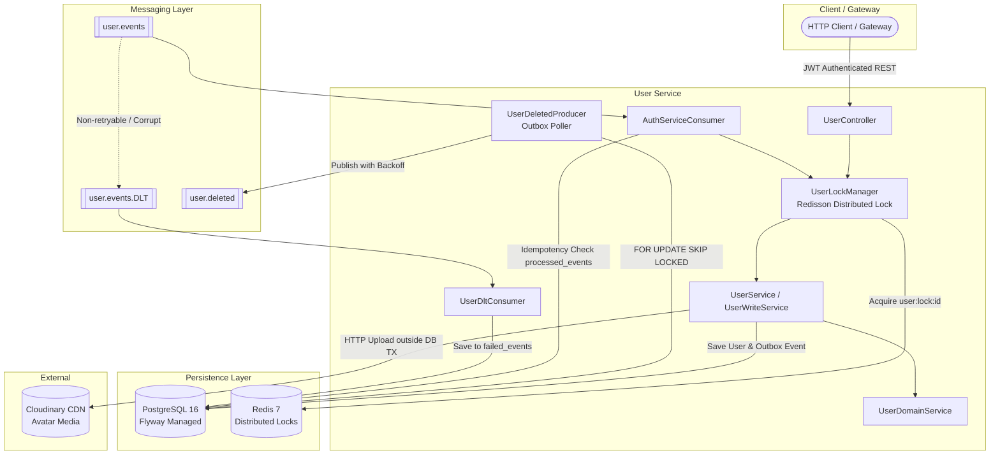
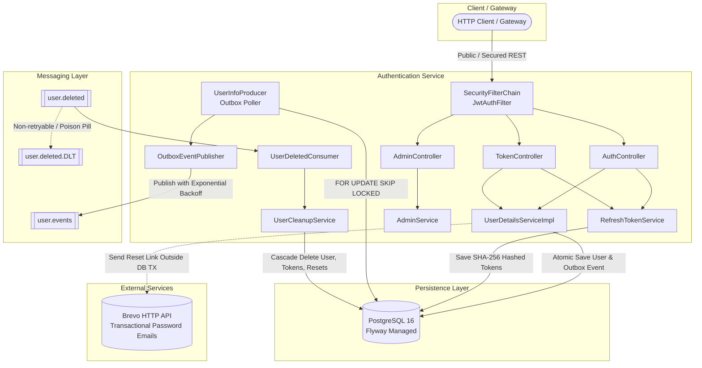
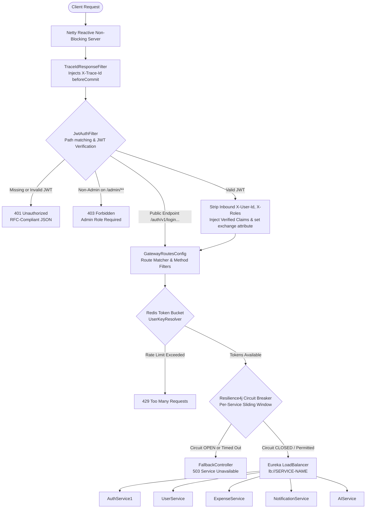
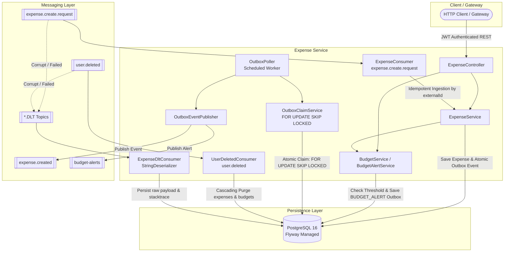

# ExpenseTracker Microservices Backend

> A distributed, event-driven financial management and expense tracking platform built with **Spring Boot 3**, **Java 21**, **Apache Kafka**, **PostgreSQL**, and **Redis**. Designed for high throughput, strict transactional consistency, and enterprise-grade resilience against distributed systems failure modes.

---

## 👤 User Service (`userService`)

The **User Service** manages user identity lifecycle, profiles, authorization metadata, and media asset storage. It acts as the source of truth for user accounts across the ecosystem, integrating asynchronously with `AuthService`, `ExpenseService`, and `NotificationService`.

---

### 🏛️ Architectural Overview & Distributed Patterns



---

### 🛡️ Core Engineering Highlights & Resiliency Patterns

#### 1. Transactional Outbox Pattern with PostgreSQL `SKIP LOCKED` Worker Leasing
- **The Problem Solved**: The dual-write problem. Deleting a user must notify downstream services (`expenseService`, `notificationService`, `authService`) via Kafka without risking ghost events or lost deletions.
- **Implementation**:
  - User deletion and outbox event persistence happen in the **exact same database transaction**.
  - Background worker leases unpublished events using `SELECT * FROM outbox_events WHERE ... FOR UPDATE SKIP LOCKED LIMIT 10`.
  - Multiple worker instances or pods process disjoint batches concurrently with zero row contention or locking bottlenecks.
  - Implements **exponential backoff** (`1s, 2s, 4s...`) on transient Kafka failures and dead-letters events after 10 failed attempts to `DEAD` status.
  - Includes `OutboxAdminService.reviveEvent(...)` for operational recovery.

#### 2. Distributed Locking with Redisson (`UserLockManager`)
- **The Problem Solved**: Eliminates race conditions, lost updates, and phantom reads when concurrent requests or duplicate Kafka events attempt to mutate the same user record.
- **Implementation**:
  - Employs Redis-backed distributed locks keyed on `user:lock:{userId}` with a 5-second acquisition timeout.
  - **Lock -> Transaction -> Commit -> Unlock ordering**: Guarantees that PostgreSQL connections are never held while waiting for distributed locks, eliminating HikariCP connection pool starvation.

#### 3. Zero-Message-Loss Consumer Idempotency
- **The Problem Solved**: Guarantees exactly-once processing semantics over Kafka’s at-least-once transport.
- **Implementation**:
  - `AuthServiceConsumer` checks the `processed_events` table before applying events.
  - Re-delivered or duplicate events (e.g. from broker rebalances or network retries) are recognized and skipped cleanly without throwing database constraint errors.

#### 4. Poison Pill Resilient Dead Letter Topic (DLT) Pipeline
- **The Problem Solved**: Corrupted, truncated, or malformed JSON payloads cannot crash consumers or block partition processing (head-of-line blocking).
- **Implementation**:
  - Configured with `DefaultErrorHandler` and a `DeadLetterPublishingRecoverer`.
  - Non-retryable exceptions (`IllegalArgumentException`, deserialization errors) are immediately forwarded to `user.events.DLT`.
  - `UserDltConsumer` uses a dedicated `dltKafkaListenerContainerFactory` with a plain `StringDeserializer` and `CommonLoggingErrorHandler`. This prevents deserialization crashes on poison pills and eliminates recursive `.DLT.DLT` infinite republishing loops.
  - Captures failed payloads, stack traces, and metadata into the `failed_events` audit table with automatic string truncation.

#### 5. Connection-Pool Safe External I/O
- Profile image uploads to Cloudinary run **outside** active database transaction boundaries.
- Database connections from HikariCP are borrowed only for the subsequent 1–2 millisecond `save` operation, preventing pool exhaustion under slow external network conditions.
- Automatic compensating transaction deletes orphaned Cloudinary assets if the database save fails.

---

### 🔌 REST API Specification

Base Path: `/api/v1/users`

| Method | Endpoint | Access Control | Description |
| :--- | :--- | :--- | :--- |
| `POST` | `/api/v1/users` | `ADMIN` or Self (`#request.userId == authentication.name`) | Creates a new user profile. |
| `GET` | `/api/v1/users/{userId}` | `ADMIN` or Self (`#userId == authentication.name`) | Retrieves profile by user ID. |
| `GET` | `/api/v1/users/emails/{email}` | `ADMIN` only | Looks up user profile by email address. |
| `PUT` | `/api/v1/users/{userId}` | `ADMIN` or Self (`#userId == authentication.name`) | Updates user details with conflict validation. |
| `DELETE` | `/api/v1/users/{userId}` | `ADMIN` or Self (`#userId == authentication.name`) | Deletes user & publishes transactional outbox event. |
| `PATCH` | `/api/v1/users/{userId}/profile-image` | `ADMIN` or Self (`#userId == authentication.name`) | Uploads avatar (Multipart: JPEG/PNG/WebP, <= 5MB). |
| `POST` | `/api/v1/users/admin/outbox/{eventId}/revive` | `ADMIN` only | Revives a `DEAD` outbox event for re-polling. |

---

### 🗄️ Database Schema & Flyway Migrations

The database is version-controlled via Flyway with strict DDL validation (`spring.jpa.hibernate.ddl-auto=validate`):

- **`V1__init_users_and_outbox.sql`**: Initial schema for `users` and `outbox_events` with partial index on unpublished events.
- **`V2__outbox_add_retry_fields.sql`**: Adds `attempt_count`, `next_retry_at`, `last_error`, `status` enum, and composite poller index.
- **`V3__processed_events.sql`**: Creates `processed_events` idempotency table scoped by consumer group.
- **`V4__failed_events.sql`**: Creates `failed_events` audit store for dead-lettered poison pill records.
- **`V5__phone_number_to_varchar_and_outbox_locked_until.sql`**: Migrates `phone_number` to international `VARCHAR(20)` format and adds lease column `locked_until` with index `idx_outbox_claimable`.

---

### 🧪 Comprehensive Integration & Chaos Testing Suite

The `userService` test suite incorporates **100+ tests** covering unit, controller, slice, and full distributed integration testing:

```bash
userService/src/test/java/sagar/userService/
├── integration/
│   ├── FlywayMigrationIntegrationTest.java        # Validates V1-V5 migration scripts on real PostgreSQL container
│   ├── OutboxConcurrencyIntegrationTest.java      # Multi-threaded SKIP LOCKED lease validation & crash recovery
│   ├── AuthServiceConsumerIntegrationTest.java    # At-least-once Kafka deduplication & idempotency verification
│   ├── UserDltIntegrationTest.java                # Poison pill routing & failed_events persistence
│   ├── OutboxPublisherIntegrationTest.java        # Outbox state machine, exponential backoff & dead-lettering
│   └── UserConcurrencyIntegrationTest.java        # Multi-threaded Redisson distributed lock contention & race conditions
```

#### Running the Test Suite:
```bash
# Run unit & mock tests
./gradlew test

# Run all integration tests (requires Docker daemon for Testcontainers)
./gradlew test --tests *IntegrationTest*
```

---

### ⚙️ Environment Variables & Configuration

| Variable | Description | Default / Example |
| :--- | :--- | :--- |
| `SERVER_PORT` | HTTP port | `9001` |
| `POSTGRES_HOST` | PostgreSQL Host | `localhost` |
| `POSTGRES_PORT` | PostgreSQL Port | `5432` |
| `POSTGRES_DB` | Database Name | `userservice` |
| `POSTGRES_USER` | Database Username | - |
| `POSTGRES_PASSWORD` | Database Password | - |
| `REDIS_HOST` | Redis Host for Distributed Locking | `localhost` |
| `REDIS_PORT` | Redis Port | `6379` |
| `KAFKA_BOOTSTRAP_SERVERS` | Kafka Broker addresses | `localhost:9092` |
| `JWT_SECRET` | HMAC Secret Key for JWT Token Validation | - |
| `CLOUDINARY_CLOUD_NAME` | Cloudinary Account Cloud Name | - |
| `CLOUDINARY_API_KEY` | Cloudinary API Key | - |
| `CLOUDINARY_API_SECRET` | Cloudinary API Secret | - |
| `EUREKA_URI` | Service Discovery Server URI | `http://localhost:8761/eureka/` |
| `ZIPKIN_ENDPOINT` | Distributed Tracing Ingestion Endpoint | `http://localhost:9411/api/v2/spans` |


---

## 🔐 Authentication Service (`AuthService1`)

The **Authentication Service** manages identity issuance, credential verification, cryptographic refresh token lifecycles, role-based access control (RBAC), and transactional user provisioning. It functions as the central OAuth2-style token issuer and authentication authority for the ExpenseTracker microservices ecosystem.

---

### 🏛️ Architectural Overview & Distributed Patterns



---

### 🛡️ Core Engineering Highlights & Resiliency Patterns

#### 1. Cryptographic Single-Use Refresh Token Rotation & SHA-256 Hashing
- **The Problem Solved**: Refresh token theft, token replay attacks, and database breach exposure. Storing plaintext refresh tokens in a database allows attackers with read-access to compromise user sessions indefinitely.
- **Implementation**:
  - The client receives a high-entropy raw UUID token. The database stores **only** the salted SHA-256 hexadecimal hash (`tokens.token_hash`, 64 characters).
  - Implements **Single-Use Token Rotation (STR)**: Rotating a refresh token atomically revokes and purges the old token hash and issues a brand-new token pair.
  - **Replay Attack Defense**: Presenting an already-rotated token returns `401 Unauthorized` immediately.
  - **Optimistic Concurrency & Double-Spend Defense**: Concurrent requests presenting the identical token simultaneously collide on database deletion; one request succeeds (`200 OK`) and the concurrent duplicate is caught and translated to `409 Conflict` / `401 Unauthorized`.

#### 2. Transactional Outbox Pattern with `FOR UPDATE SKIP LOCKED` Worker Leasing
- **The Problem Solved**: The dual-write problem during account signup. Saving a user to the database while publishing an event to Kafka in separate operations risks orphan accounts or lost events upon broker failures.
- **Implementation**:
  - User creation and `USER_CREATED` outbox event persistence occur within the **exact same database transaction**.
  - Background worker (`UserInfoProducer`) leases pending events using `SELECT * FROM outbox_events WHERE ... FOR UPDATE SKIP LOCKED LIMIT 10` with a 30-second lease lock (`locked_until`).
  - Implements **exponential backoff** (`1s, 2s, 4s...` capped at `5m`) on transient Kafka failures and dead-letters events after 10 failed attempts (`DEAD` status) with truncated error tracking.

#### 3. Anti-Enumeration & Session-Revocation Password Reset Flow
- **The Problem Solved**: Account enumeration attacks and active session persistence after credential compromise.
- **Implementation**:
  - Calling `/auth/v1/forgot-password` with an unregistered email returns `200 OK ("Password reset email sent")` without leaking account existence.
  - Tokens expire after 15 minutes, are single-use, and are stored only as SHA-256 hashes.
  - **Complete Session Invalidation**: Successfully resetting a password immediately wipes **all active refresh tokens** for that user across every mobile and web device, forcing full re-authentication.

#### 4. Spring Security 6 & Stateless JWT Architecture
- **The Problem Solved**: Secure token parsing without database lookups across downstream microservices.
- **Implementation**:
  - Stateless architecture (`SessionCreationPolicy.STATELESS`) with a customized `JwtAuthFilter`.
  - Spring Security's internal `UserDetails` model is cleanly isolated within `AuthService1` (`CustomUserDetails`).
  - Downstream services (`userService`, `expenseService`, `gateway`) validate raw JWT signature claims independently without coupling to `AuthService1`'s internal persistence entities.

#### 5. Cascading Relational Event-Driven Cleanup (`user.deleted`)
- **The Problem Solved**: Eliminating orphaned credentials and tokens when a user account is deleted by the `userService`.
- **Implementation**:
  - `UserDeletedConsumer` consumes `user.deleted` and executes an atomic cascading purge across `RefreshToken`, `PasswordResetToken`, and `UserInfo`.
  - Fully idempotent: duplicate Kafka messages exit gracefully without throwing constraint or not-found exceptions.
  - Includes daily background housekeeping (`cleanupExpiredPasswordTokens`) to prune stale reset tokens.

#### 6. Resilient Kafka Dead-Letter-Topic (DLT) Pipeline
- **The Problem Solved**: Malformed or unparseable payloads (poison pills) blocking partition consumption.
- **Implementation**:
  - Configured with `DefaultErrorHandler` and a `DeadLetterPublishingRecoverer` routing unrecoverable records to `user.deleted.DLT`.
  - Employs `ErrorHandlingDeserializer` to trap deserialization errors before reaching consumer business logic.

---

### 🔌 REST API Specification

Base Path: `/auth/v1`

| Method | Endpoint | Access Control | Description |
| :--- | :--- | :--- | :--- |
| `POST` | `/auth/v1/signup` | Public | Registers a new user, persists atomic outbox event, and returns access/refresh tokens. |
| `POST` | `/auth/v1/login` | Public | Authenticates username & password; returns JWT access token and refresh token. |
| `POST` | `/auth/v1/refreshToken` | Public | Rotates single-use refresh token; invalidates old token and returns new token pair. |
| `POST` | `/auth/v1/forgot-password` | Public | Anti-enumeration password reset dispatch; generates hashed token & emails reset link. |
| `POST` | `/auth/v1/reset-password` | Public | Verifies token, updates password, marks token used, and revokes all active sessions. |
| `POST` | `/auth/v1/change/passwords`| Authenticated | Updates account password and invalidates active refresh tokens. |
| `POST` | `/auth/v1/change/username` | Authenticated | Updates username and issues refreshed JWT token. |
| `GET`  | `/auth/v1/ping` | Authenticated | Verifies authentication token and returns authenticated `userId`. |
| `GET`  | `/auth/v1/health` | Public | Liveness probe returning service status and timestamp. |
| `POST` | `/auth/v1/admin/users/{userId}/promote` | `ROLE_ADMIN` | Promotes target user to administrator (`204 No Content`). |
| `DELETE`| `/auth/v1/admin/users/{userId}/admin` | `ROLE_ADMIN` | Demotes admin user and immediately revokes all their active sessions. |

---

### 🗄️ Database Schema & Flyway Migrations

The database is version-controlled via Flyway with strict DDL validation (`spring.jpa.hibernate.ddl-auto=validate`):

- **`V1__init_auth.sql`**: Initial schema for `users`, `user_roles` (element collection join table with foreign-key cascade), `tokens` (refresh tokens), and `outbox_events`.
- **`V2__outbox_add_retry_fields.sql`**: Adds transactional outbox retry tracking columns (`attempt_count`, `next_retry_at`, `last_error`, `status`).
- **`V3__reset_pass_token.sql`**: Creates `password_reset_tokens` table with foreign-key cascade and index on token hash.
- **`V4__allow_multiple_tokens_per_user.sql`**: Drops unique constraint on `tokens.user_id` to support concurrent multi-device logins.
- **`V5__outbox_add_locked_until.sql`**: Adds `locked_until` column and `idx_outbox_claimable` index for non-blocking worker leasing.

---

### 🧪 Comprehensive Integration & Concurrency Testing Suite

The `AuthService1` test suite incorporates **120+ unit tests** and **21 PBC-grade integration tests** covering security guards, replay attacks, race conditions, and event cleanup:

```bash
AuthService1/app/src/test/java/org/example/
├── integration/
│   ├── SignupIntegrationTest.java           # Atomic outbox write & duplicate username conflict guards
│   ├── RefreshTokenIntegrationTest.java      # Single-use rotation, SHA-256 DB verification, replay defense & 2-thread starter-pistol race test
│   ├── PasswordResetIntegrationTest.java     # Anti-enumeration, email interception with ArgumentCaptor, password update & session wipe
│   ├── AdminSecurityIntegrationTest.java     # RBAC enforcement, 401/403 rejection, admin promotion/demotion & session termination
│   └── UserCleanupIntegrationTest.java       # user.deleted consumer cascade deletion, idempotency & token housekeeping
```

#### Running the Test Suite:
```bash
# Run all unit tests
.\gradlew.bat test

# Run all integration test suites
.\gradlew.bat test --tests org.example.integration.* --no-daemon

# Run specific integration test suite
.\gradlew.bat test --tests org.example.integration.RefreshTokenIntegrationTest --no-daemon
```

---

### ⚙️ Environment Variables & Configuration

| Variable | Description | Default / Example |
| :--- | :--- | :--- |
| `SERVER_PORT` | HTTP port | `9898` |
| `POSTGRES_HOST` | PostgreSQL Host | `localhost` |
| `POSTGRES_PORT` | PostgreSQL Port | `5432` |
| `POSTGRES_DB` | Database Name | `authservice` |
| `POSTGRES_USER` | Database Username | - |
| `POSTGRES_PASSWORD` | Database Password | - |
| `KAFKA_BOOTSTRAP_SERVERS` | Kafka Broker addresses | `localhost:9092` |
| `JWT_SECRET` | Base64-encoded HMAC-SHA256 Secret (>= 256 bits) | - |
| `JWT_EXPIRATION` | Access token lifespan (ms) | `3600000` (1 hour) |
| `JWT_REFRESH_EXPIRATION`| Refresh token lifespan (ms) | `604800000` (7 days) |
| `BREVO_API_KEY` | Brevo (Sendinblue) Transactional Email API Key | - |
| `BREVO_SENDER_EMAIL` | Originating email address | `noreply@expensetracker.com` |
| `BREVO_SENDER_NAME` | Originating sender name | `Expense Tracker` |
| `EUREKA_URI` | Service Discovery Server URI | `http://localhost:8761/eureka/` |
| `ZIPKIN_ENDPOINT` | Distributed Tracing Ingestion Endpoint | `http://localhost:9411/api/v2/spans` |

---

## 🌐 API Gateway (`gateway`)

The **API Gateway** acts as the high-throughput, non-blocking edge reverse proxy and security perimeter for the ExpenseTracker microservices ecosystem. Built on **Spring Cloud Gateway (Spring Boot 3.5.5, Java 21)** with **Project Reactor** and **Netty**, it performs non-blocking cryptographic JWT authentication, RBAC authorization, anti-spoofing header cleansing, distributed Redis rate limiting, Resilience4j circuit breaking, and distributed trace propagation.

---

### 🏛️ Architectural Overview & Filter Pipeline



---

### 🛡️ Core Security & Engineering Highlights

#### 1. Zero-Trust Inbound Header Sanitization & Anti-Spoofing
- **The Problem Solved**: Attackers could forge downstream identity headers (`X-User-Id`, `X-Username`, `X-Roles: ROLE_ADMIN`) to elevate privileges or impersonate arbitrary accounts.
- **Implementation**:
  - `JwtAuthFilter` unconditionally mutates the inbound request to strip client-supplied identity headers:
    ```java
    httpHeaders.remove("X-User-Id");
    httpHeaders.remove("X-Username");
    httpHeaders.remove("X-Roles");
    ```
  - Re-injects verified identity headers **solely** from cryptographically validated JWT claims (`subject`, `userId`, `roles`).
  - Sets `exchange.getAttributes().put("userId", userId)` so downstream filters consume trusted server-side state.

#### 2. Defense-in-Depth Path Protection & Admin RBAC
- **The Problem Solved**: Sub-path prefix spoofing or forgotten role checks on internal administration routes.
- **Implementation**:
  - Public routes (`/auth/v1/login`, `/auth/v1/signup`, `/auth/v1/refreshToken`, `/auth/v1/forgot-password`, `/auth/v1/reset-password`) are strictly evaluated using exact collection lookup (`PUBLIC.contains(path)`), preventing prefix-matching bypasses.
  - Defense-in-depth admin protection checks `path.contains("/admin")` and enforces `ROLE_ADMIN` membership, guarding admin endpoints across all microservices (Auth and User services) before requests ever reach internal controllers.

#### 3. Attribute-Driven Distributed Rate Limiting (`UserKeyResolver`)
- **The Problem Solved**: Header-based rate limiting allows attackers to spoof client headers or IPs to exhaust other users' quotas.
- **Implementation**:
  - `UserKeyResolver` extracts the rate-limiting key directly from server-side `exchange.getAttribute("userId")`.
  - Authenticated traffic is keyed as `user:{userId}`, ensuring strict per-user rate quotas regardless of proxy hops or IP rotation.
  - Unauthenticated public endpoints (e.g. login/signup) fall back to client IP (`exchange.getRequest().getRemoteAddress()`), guarded with null-safety defaults (`"unknown-client"`).

#### 4. Multi-Tier Token Bucket Rate Limiting (Redis)
- **The Problem Solved**: Different endpoint categories impose vastly different load characteristics and costs.
- **Implementation**:
  - **Auth Limiter (`authRateLimiter`)**: `1 req/sec`, burst `5`. Prevents credential stuffing and brute-force attacks on `/auth/**`.
  - **Read Limiter (`readRateLimiter`)**: `10 req/sec`, burst `50`. High throughput for cached read requests (`GET` queries).
  - **Write Limiter (`writeRateLimiter`)**: `5 req/sec`, burst `20`. Mid-tier protection for state-mutating requests (`POST`, `PUT`, `PATCH`, `DELETE`).
  - **AI / SMS Limiter (`aiRateLimiter`)**: `1 req/2sec`, burst `10` (token cost = 2). Strictly limits high-cost third-party LLM and SMS invocations.

#### 5. Resilience4j Circuit Breaking & TimeLimiter Isolation
- **The Problem Solved**: Cascading latency, thread exhaustion, and hung connections when a downstream microservice experiences degradation.
- **Implementation**:
  - Every route is wrapped with a named Resilience4j Circuit Breaker instance (`auth-service-cb`, `user-service-cb`, `expense-service-cb`, `notification-service-cb`, `ai-service-cb`).
  - Dedicated TimeLimiter configurations: User service allows `30s` timeout for Cloudinary file uploads, while standard services timeout at `5s`.
  - When failure rate exceeds 50% or slow calls exceed 80%, the circuit opens, redirecting requests to non-blocking fallback endpoints in `FallbackController` (`HTTP 503 Service Unavailable`).

#### 6. Distributed Tracing & Response Header Propagation
- **The Problem Solved**: Correlating client requests with downstream microservice logs in distributed environments.
- **Implementation**:
  - Integrated with **Micrometer Tracing** and OpenTelemetry / Zipkin.
  - `TraceIdResponseFilter` runs with `Ordered.LOWEST_PRECEDENCE` and registers a `beforeCommit` reactive hook on the response:
    ```java
    exchange.getResponse().beforeCommit(() -> {
        Span currentSpan = this.tracer.currentSpan();
        if (currentSpan != null) {
            exchange.getResponse().getHeaders().add("X-Trace-Id", currentSpan.context().traceId());
        }
        return Mono.empty();
    });
    ```
  - Returns `X-Trace-Id` on all outbound responses to clients for end-to-end auditability.

---

### 🚦 Gateway Routing Table

| Route ID | Path Pattern | HTTP Method | Rate Limiter | Circuit Breaker | Target URI |
| :--- | :--- | :--- | :--- | :--- | :--- |
| `auth-service` | `/auth/**` | Any | `authRateLimiter` (1 rps, burst 5) | `auth-service-cb` | `lb://AUTH-SERVICE` |
| `user-service-reads` | `/api/v1/users/**` | `GET` | `readRateLimiter` (10 rps, burst 50) | `user-service-cb` | `lb://USER-SERVICE` |
| `user-service-writes` | `/api/v1/users/**` | `POST`, `PUT`, `PATCH`, `DELETE` | `writeRateLimiter` (5 rps, burst 20) | `user-service-cb` | `lb://USER-SERVICE` |
| `expense-service-reads` | `/api/v1/expenses/**` | `GET` | `readRateLimiter` (10 rps, burst 50) | `expense-service-cb` | `lb://EXPENSE-SERVICE` |
| `expense-service-writes` | `/api/v1/expenses/**` | `POST`, `PUT`, `PATCH`, `DELETE` | `writeRateLimiter` (5 rps, burst 20) | `expense-service-cb` | `lb://EXPENSE-SERVICE` |
| `notification-service-reads` | `/api/v1/notifications/**` | `GET` | `readRateLimiter` (10 rps, burst 50) | `notification-service-cb` | `lb://NOTIFICATION-SERVICE` |
| `notification-service` | `/api/v1/notifications/**` | `POST`, `PUT`, `PATCH`, `DELETE` | `writeRateLimiter` (5 rps, burst 20) | `notification-service-cb` | `lb://NOTIFICATION-SERVICE` |
| `ai-service` | `/api/v1/sms/**` | Any | `aiRateLimiter` (0.5 rps, burst 10) | `ai-service-cb` | `lb://AI-SERVICE` |

---

### 🧪 Comprehensive Gateway Testing Suite

The Gateway test suite leverages **Spring Cloud Gateway Test**, **Project Reactor StepVerifier**, and **MockServerWebExchange** for isolated reactive verification:

```bash
gateway/src/test/java/com/greatest/gateway/
├── GatewayApplicationTests.java    # Full reactive Spring context bootstrap validation
├── JwtAuthFilterTest.java          # Reactive WebFlux filter verification (StepVerifier):
│                                   #  - Public path pass-through
│                                   #  - Missing token 401 Unauthorized rejection
│                                   #  - Non-admin 403 Forbidden rejection
│                                   #  - Header spoofing cleansing & verified claims injection
├── JwtUtilTest.java                # HMAC-SHA256 signature validation, expiry checks & required claims assertions
└── UserKeyResolverTest.java        # Server attribute resolution, client IP fallback & null-safety validation
```

#### Running Gateway Tests:
```bash
# Run all gateway tests
cd gateway
.\mvnw.cmd test

# Run a clean build and test run
.\mvnw.cmd clean test
```

---

### ⚙️ Environment Variables & Configuration

| Variable | Description | Default / Example |
| :--- | :--- | :--- |
| `SERVER_PORT` | HTTP Port for Gateway | `8080` |
| `REDIS_HOST` | Redis Server Hostname | `localhost` |
| `REDIS_PORT` | Redis Server Port | `6379` |
| `EUREKA_URI` | Service Discovery Server URI | `http://localhost:8761/eureka/` |
| `JWT_SECRET` | Base64-encoded HMAC-SHA256 Secret (>= 256 bits) | - |
| `JWT_EXPIRATION` | Access Token Expiration (ms) | `3600000` (1 hour) |
| `JWT_REFRESH_EXPIRATION` | Refresh Token Expiration (ms) | `604800000` (7 days) |
| `ZIPKIN_ENDPOINT` | Distributed Tracing OTLP / Zipkin Ingestion | `http://localhost:9411/api/v2/spans` |

---

## 💰 Expense Service (`expenseService`)

The **Expense Service** manages transaction lifecycles, categorized spending records, monthly category budgets, automated budget threshold alerts, and multi-dimensional financial aggregations. It enforces strict per-user idempotency, optimistic concurrency locking, distributed multi-instance outbox leasing, and poison-pill resilient event consumption.

---

### 🏛️ Architectural Overview & Distributed Patterns



---

### 🛡️ Core Engineering Highlights & Resiliency Patterns

#### 1. Multi-Instance Safe Transactional Outbox (`FOR UPDATE SKIP LOCKED`)
- **The Problem Solved**: The dual-write problem during financial transaction creation. If the database commit succeeds but publishing to Kafka fails (or vice versa), state drifts across services. Furthermore, running multiple replicas of `expense-service` risks duplicate publishes without distributed coordination.
- **Implementation**:
  - Every expense creation or budget alert threshold trigger atomically saves an `OutboxEvent` (`status = PENDING`, `next_retry_at = NOW()`) inside the **exact same ACID database transaction** as the domain entity.
  - Dedicated background leasing service (`OutboxClaimService`) uses PostgreSQL native row-level locking:
    ```sql
    SELECT * FROM outbox_events
    WHERE (status = 'PENDING' AND next_retry_at <= :now)
       OR (status = 'PROCESSING' AND locked_until <= :now)
    ORDER BY created_at ASC
    LIMIT :limit
    FOR UPDATE SKIP LOCKED
    ```
  - **Dead Worker Recovery**: If a worker crashes mid-publish, other instances automatically reclaim expired leases (`status = 'PROCESSING' AND locked_until <= :now`) after the 60-second lease window.
  - **Exponential Backoff**: Transient Kafka failures back off exponentially (`1s, 2s, 4s...` capped at `5m`) up to 10 attempts before transitioning to `DEAD` status with truncated error logging.

#### 2. DLT Poison Pill Resiliency & Raw String Ingestion
- **The Problem Solved**: When a message on Kafka is corrupted (e.g. invalid JSON syntax), typed consumers (`JsonDeserializer`) throw deserialization exceptions inside the native Kafka client polling loop, causing infinite crash loops and partition starvation.
- **Implementation**:
  - `KafkaConsumerConfig` wraps all `JsonDeserializer` instances with `ErrorHandlingDeserializer`. Bad payloads are intercepted, tagged with failure headers, and passed to Spring's `DefaultErrorHandler`.
  - Non-retryable errors (`DeserializationException`, `IllegalArgumentException`) immediately route to `.DLT` via `DeadLetterPublishingRecoverer` without wasteful retries.
  - **Poison-Proof DLT Ingestion**: `ExpenseDltConsumer` uses a dedicated `dltKafkaListenerContainerFactory` configured with **`StringDeserializer`**. It consumes the raw payload as a plain `String` (never re-parsing JSON), preventing recursive DLT crashes, and safely persists diagnostic details to the `failed_events` table with a 1000-character safety truncation on error messages.

#### 3. Client-Driven Idempotency (`externalId` & Unique Constraint)
- **The Problem Solved**: Network timeouts causing client retries, leading to double-billing or duplicate expense records.
- **Implementation**:
  - The client provides a unique UUID `externalId` per transaction.
  - PostgreSQL enforces a composite unique constraint:
    ```sql
    CONSTRAINT uk_user_external UNIQUE (user_id, external_id)
    ```
  - `ExpenseService.createExpense()` performs an idempotency lookup: if an expense already exists for `(userId, externalId)`, it returns the existing entity immediately (`HTTP 201 Created`) without re-executing budget checks or generating duplicate outbox events.

#### 4. Automated Budget Alert Threshold Engine
- **The Problem Solved**: Alert fatigue and duplicate notifications when multiple expenses occur near category limits.
- **Implementation**:
  - Upon every expense persistence, `BudgetAlertService` calculates current monthly expenditure against the category's configured monthly budget.
  - Detects threshold crossings (`50%`, `80%`, `100%`).
  - Tracks `last_alert_threshold` on the `Budget` entity. If a user spends more while remaining within the same threshold tier (e.g. 82% to 88%), redundant alert events are suppressed.
  - When a new threshold is crossed, an atomic `BUDGET_ALERT` event is persisted to `outbox_events` for downstream push notification dispatch.

#### 5. Optimistic Concurrency Control (`@Version`)
- **The Problem Solved**: Lost updates when concurrent clients update the same expense record.
- **Implementation**:
  - `Expense` entity leverages Hibernate `@Version private Long version;`.
  - Concurrent modifications trigger `ObjectOptimisticLockingFailureException`, which `GlobalExceptionHandler` intercepts and translates to a clean `HTTP 409 Conflict`.

#### 6. Cascading Event-Driven Account Purge (`user.deleted`)
- **The Problem Solved**: GDPR / data retention compliance and storage cleanup when an account is deleted in `userService`.
- **Implementation**:
  - `UserDeletedConsumer` consumes `user.deleted` events.
  - `UserCleanupService` executes an atomic deletion across all `expenses` and `budget` entries belonging to the user in a single transaction.

---

### 🔌 REST API Specification

Base Path: `/api/v1/expenses`  
*All endpoints require Bearer JWT authentication unless noted otherwise. User identity is derived strictly from the verified security context (`authentication.getName()`).*

| Method | Endpoint | Description | Query / Body Parameters |
| :--- | :--- | :--- | :--- |
| `POST` | `/api/v1/expenses` | Creates an expense transaction (Idempotent via `externalId`). | JSON: `ExpenseDto` (`amount`, `category`, `type`, `title`, `transactionDate`, `externalId`) |
| `PUT` | `/api/v1/expenses` | Updates an existing expense transaction. | JSON: `ExpenseDto` (`externalId`, updated fields) |
| `GET` | `/api/v1/expenses/{externalId}` | Fetches a specific expense transaction by external ID. | Path: `externalId` |
| `DELETE` | `/api/v1/expenses/{externalId}` | Deletes an expense transaction (`204 No Content`). | Path: `externalId` |
| `GET` | `/api/v1/expenses` | Paginated and filtered expense transaction history. | Params: `page`, `size`, `sortBy`, `ascending`, `category`, `type`, `minAmount`, `maxAmount`, `fromDate`, `toDate` |
| `GET` | `/api/v1/expenses/summary` | Aggregated total income, expenditure, and net balance. | None |
| `GET` | `/api/v1/expenses/analytics/category`| Aggregated total spending grouped by category. | None |
| `GET` | `/api/v1/expenses/analytics/monthly` | Historical monthly expenditure breakdown. | None |
| `POST` | `/api/v1/expenses/budgets` | Creates or updates a monthly category budget. | JSON: `BudgetDto` (`category`, `amount`, `month`, `year`) |
| `GET` | `/api/v1/expenses/budgets/status` | Current budget utilization and remaining balance. | Params: `month` (1–12), `year` (>= 2000) |

---

### 🗄️ Database Schema & Flyway Migrations

The database is version-controlled via Flyway:

```bash
expenseService/src/main/resources/db/migration/
├── V1__init_expense_schema.sql         # Core schema: expenses, budget, outbox_events, processed_events, failed_events
└── V2__outbox_add_locked_until.sql     # Multi-instance leasing: locked_until column & idx_outbox_claimable index
```

---

### 🧪 Comprehensive Testing Suite

The `expenseService` test suite provides multi-layered coverage across unit, slice, and integration layers:

```bash
expenseService/src/test/java/com/greatest/expenseService/
├── ExpenseServiceApplicationTests.java # Spring Boot context bootstrap smoke test
├── integration/
│   └── ExpenseIntegrationTest.java     # E2E MockMvc + H2 + Outbox integration test (Creation, Idempotency, Budget Alerts)
├── controllers/
│   └── ExpenseControllerTest.java      # MockMvc WebMvc slice tests (Validation, Security Principal, Query Filters)
├── services/
│   ├── ExpenseServiceTest.java         # Domain logic, idempotency, updates, soft checks
│   ├── BudgetServiceTest.java          # Budget limits, status computation, percentages
│   ├── BudgetAlertServiceTest.java     # Threshold detection (50%, 80%, 100%) & suppression
│   ├── OutboxClaimServiceTest.java     # Lease acquisition, status transitions & lock expiration
│   └── UserCleanupServiceTest.java     # Cascading user purge
├── producers/
│   └── OutboxEventPublisherTest.java   # Kafka publish success, backoff calculation & DEAD transitions
├── consumer/
│   ├── ExpenseConsumerTest.java        # Kafka listener invocation
│   ├── ExpenseDeserializerTest.java    # Jackson date serialization & DeserializationException handling
│   ├── ExpenseDltConsumerTest.java     # Raw string DLT ingestion & failed_events persistence
│   └── UserDeletedConsumerTest.java    # Account cleanup delegation
└── repository/
    ├── ExpenseRepositoryTest.java      # Summary projection, spending aggregation, custom specifications
    └── BudgetRepositoryTest.java       # Category month/year composite queries
```

#### Running Expense Service Tests:
```bash
# Run all tests in expenseService
cd expenseService
.\mvnw.cmd test

# Run integration tests specifically
.\mvnw.cmd test -Dtest=ExpenseIntegrationTest
```

---

### ⚙️ Environment Variables & Configuration

| Variable | Description | Default / Example |
| :--- | :--- | :--- |
| `SERVER_PORT` | HTTP Port | `9810` |
| `POSTGRES_HOST` | Database Hostname | `localhost` |
| `POSTGRES_PORT` | Database Port | `5432` |
| `POSTGRES_DB` | Database Name | `expenseservice` |
| `POSTGRES_USER` | Database Username | `postgres` |
| `POSTGRES_PASSWORD` | Database Password | - |
| `KAFKA_BOOTSTRAP_SERVERS` | Kafka Broker List | `localhost:9092` |
| `JWT_SECRET` | Base64-encoded HMAC-SHA256 Secret (>= 256 bits) | - |
| `EUREKA_URI` | Eureka Service Registry | `http://localhost:8761/eureka/` |
| `ZIPKIN_ENDPOINT` | Distributed Tracing Endpoint | `http://localhost:9411/api/v2/spans` |
