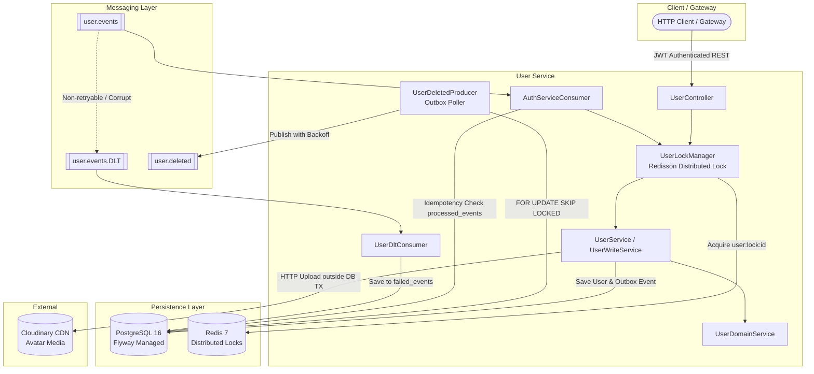

# User Service (`userService`)

> A high-throughput, fault-tolerant user identity and profile management microservice built with **Spring Boot 3.5**, **Java 21**, **Apache Kafka**, **PostgreSQL**, and **Redis**.

---

### 🏛️ Architectural Overview & Distributed Patterns



---

### 🛡️ Core Engineering Highlights & Resiliency Patterns

#### 1. Transactional Outbox Pattern with PostgreSQL `SKIP LOCKED` Worker Leasing
- **The Problem Solved**: The dual-write problem. Deleting a user must notify downstream services (`expenseService`, `notificationService`, `authService`) via Kafka without risking ghost events or lost deletions.
- **Implementation**:
  - User deletion and outbox event persistence happen in the **exact same database transaction**.
  - Background worker leases unpublished events using `SELECT * FROM outbox_events WHERE ... FOR UPDATE SKIP LOCKED LIMIT 10`.
  - Multiple worker instances or pods process disjoint batches concurrently with zero row contention or locking bottlenecks.
  - Implements **exponential backoff** (`1s, 2s, 4s...`) on transient Kafka failures and dead-letters events after 10 failed attempts to `DEAD` status.
  - Includes `OutboxAdminService.reviveEvent(...)` for operational recovery.

#### 2. Distributed Locking with Redisson (`UserLockManager`)
- **The Problem Solved**: Eliminates race conditions, lost updates, and phantom reads when concurrent requests or duplicate Kafka events attempt to mutate the same user record.
- **Implementation**:
  - Employs Redis-backed distributed locks keyed on `user:lock:{userId}` with a 5-second acquisition timeout.
  - **Lock -> Transaction -> Commit -> Unlock ordering**: Guarantees that PostgreSQL connections are never held while waiting for distributed locks, eliminating HikariCP connection pool starvation.

#### 3. Zero-Message-Loss Consumer Idempotency
- **The Problem Solved**: Guarantees exactly-once processing semantics over Kafka’s at-least-once transport.
- **Implementation**:
  - `AuthServiceConsumer` checks the `processed_events` table before applying events.
  - Re-delivered or duplicate events (e.g. from broker rebalances or network retries) are recognized and skipped cleanly without throwing database constraint errors.

#### 4. Poison Pill Resilient Dead Letter Topic (DLT) Pipeline
- **The Problem Solved**: Corrupted, truncated, or malformed JSON payloads cannot crash consumers or block partition processing (head-of-line blocking).
- **Implementation**:
  - Configured with `DefaultErrorHandler` and a `DeadLetterPublishingRecoverer`.
  - Non-retryable exceptions (`IllegalArgumentException`, deserialization errors) are immediately forwarded to `user.events.DLT`.
  - `UserDltConsumer` uses a dedicated `dltKafkaListenerContainerFactory` with a plain `StringDeserializer` and `CommonLoggingErrorHandler`. This prevents deserialization crashes on poison pills and eliminates recursive `.DLT.DLT` infinite republishing loops.
  - Captures failed payloads, stack traces, and metadata into the `failed_events` audit table with automatic string truncation.

#### 5. Connection-Pool Safe External I/O
- Profile image uploads to Cloudinary run **outside** active database transaction boundaries.
- Database connections from HikariCP are borrowed only for the subsequent 1–2 millisecond `save` operation, preventing pool exhaustion under slow external network conditions.
- Automatic compensating transaction deletes orphaned Cloudinary assets if the database save fails.

---

### 🔌 REST API Specification

Base Path: `/api/v1/users`

| Method | Endpoint | Access Control | Description |
| :--- | :--- | :--- | :--- |
| `POST` | `/api/v1/users` | `ADMIN` or Self (`#request.userId == authentication.name`) | Creates a new user profile. |
| `GET` | `/api/v1/users/{userId}` | `ADMIN` or Self (`#userId == authentication.name`) | Retrieves profile by user ID. |
| `GET` | `/api/v1/users/emails/{email}` | `ADMIN` only | Looks up user profile by email address. |
| `PUT` | `/api/v1/users/{userId}` | `ADMIN` or Self (`#userId == authentication.name`) | Updates user details with conflict validation. |
| `DELETE` | `/api/v1/users/{userId}` | `ADMIN` or Self (`#userId == authentication.name`) | Deletes user & publishes transactional outbox event. |
| `PATCH` | `/api/v1/users/{userId}/profile-image` | `ADMIN` or Self (`#userId == authentication.name`) | Uploads avatar (Multipart: JPEG/PNG/WebP, <= 5MB). |
| `POST` | `/api/v1/users/admin/outbox/{eventId}/revive` | `ADMIN` only | Revives a `DEAD` outbox event for re-polling. |

---

### 🗄️ Database Schema & Flyway Migrations

The database is version-controlled via Flyway with strict DDL validation (`spring.jpa.hibernate.ddl-auto=validate`):

- **`V1__init_users_and_outbox.sql`**: Initial schema for `users` and `outbox_events` with partial index on unpublished events.
- **`V2__outbox_add_retry_fields.sql`**: Adds `attempt_count`, `next_retry_at`, `last_error`, `status` enum, and composite poller index.
- **`V3__processed_events.sql`**: Creates `processed_events` idempotency table scoped by consumer group.
- **`V4__failed_events.sql`**: Creates `failed_events` audit store for dead-lettered poison pill records.
- **`V5__phone_number_to_varchar_and_outbox_locked_until.sql`**: Migrates `phone_number` to international `VARCHAR(20)` format and adds lease column `locked_until` with index `idx_outbox_claimable`.

---

### 🧪 Comprehensive Integration & Chaos Testing Suite

The `userService` test suite incorporates **100+ tests** covering unit, controller, slice, and full distributed integration testing:

```bash
userService/src/test/java/sagar/userService/
├── integration/
│   ├── FlywayMigrationIntegrationTest.java        # Validates V1-V5 migration scripts on real PostgreSQL container
│   ├── OutboxConcurrencyIntegrationTest.java      # Multi-threaded SKIP LOCKED lease validation & crash recovery
│   ├── AuthServiceConsumerIntegrationTest.java    # At-least-once Kafka deduplication & idempotency verification
│   ├── UserDltIntegrationTest.java                # Poison pill routing & failed_events persistence
│   ├── OutboxPublisherIntegrationTest.java        # Outbox state machine, exponential backoff & dead-lettering
│   └── UserConcurrencyIntegrationTest.java        # Multi-threaded Redisson distributed lock contention & race conditions
```

#### Running the Test Suite:
```bash
# Run unit & mock tests
./gradlew test

# Run all integration tests (requires Docker daemon for Testcontainers)
./gradlew test --tests *IntegrationTest*
```

---

### ⚙️ Environment Variables & Configuration

| Variable | Description | Default / Example |
| :--- | :--- | :--- |
| `SERVER_PORT` | HTTP port | `9001` |
| `POSTGRES_HOST` | PostgreSQL Host | `localhost` |
| `POSTGRES_PORT` | PostgreSQL Port | `5432` |
| `POSTGRES_DB` | Database Name | `userservice` |
| `POSTGRES_USER` | Database Username | - |
| `POSTGRES_PASSWORD` | Database Password | - |
| `REDIS_HOST` | Redis Host for Distributed Locking | `localhost` |
| `REDIS_PORT` | Redis Port | `6379` |
| `KAFKA_BOOTSTRAP_SERVERS` | Kafka Broker addresses | `localhost:9092` |
| `JWT_SECRET` | HMAC Secret Key for JWT Token Validation | - |
| `CLOUDINARY_CLOUD_NAME` | Cloudinary Account Cloud Name | - |
| `CLOUDINARY_API_KEY` | Cloudinary API Key | - |
| `CLOUDINARY_API_SECRET` | Cloudinary API Secret | - |
| `EUREKA_URI` | Service Discovery Server URI | `http://localhost:8761/eureka/` |
| `ZIPKIN_ENDPOINT` | Distributed Tracing Ingestion Endpoint | `http://localhost:9411/api/v2/spans` |
